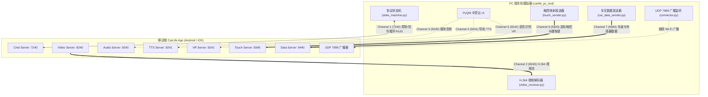
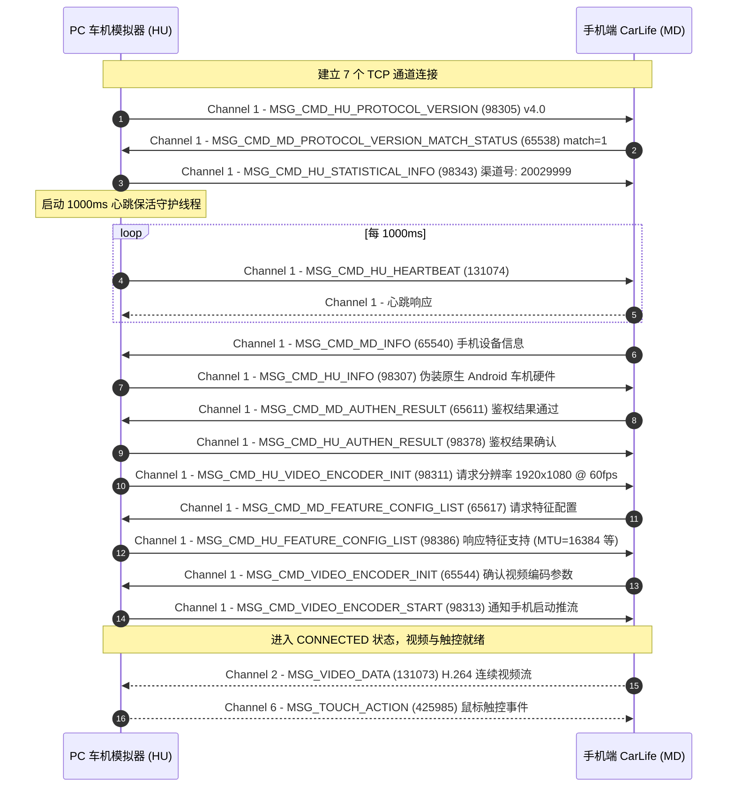

# CarLife 电脑端车机模拟测试工具 ( Carlife PC Tool )

[](https://www.python.org/)
[](https://www.riverbankcomputing.com/software/pyqt/)
[](https://pyav.org/)
[](https://protobuf.dev/)
[](#-免责声明-disclaimer)

本项目是基于逆向百度 CarLife 车机端官方 App (`com.baidu.carlifevehiclef`) 的底层通信协议构建的PC端车机模拟器。
可直接在多平台（Windows / Linux / macOS）上**连接、测试、调试基于CarLife通道的车机互联系统**。

> [!WARNING]
> ### ⚠️ 免责声明 (Disclaimer)
>
> 1. **仅限学术交流与协议研究**：本项目属于个人业余对车载互联协议、嵌入式通信网络及逆向工程的**学术技术交流与学习研究成果**，旨在探究多通道 TCP 传输、低延迟 H.264 视频流解码渲染与动态 Protobuf 编解码原理。
> 2. **严禁用于任何商业用途**：本项目严禁用于任何商业销售、营利性服务、车载硬件商业改装、商用前装/后装车机系统开发或任何商业衍生产品中。使用者不得利用本项目牟取任何经济利益。
> 3. **商标与知识产权声明**：“CarLife” 及相关图形标识、通信协议规范与官方 APK（包括但不限于 `com.baidu.carlifevehiclef` / `com.baidu.carlife`）的相关知识产权均归属于**北京百度网讯科技有限公司（Baidu, Inc.）**。本项目为独立第三方的逆向技术探索实现，与百度公司不存在任何商业隶属、授权合作、赞助或背书关系。
> 4. **行车安全与法律责任**：本项目仅限在室内个人计算机调试环境中运行，**严禁在机动车行驶过程中使用**；任何个人或组织因直接或间接使用、修改、分发本仓库代码所产生的任何财产损失、人身伤害、行车安全事故、侵权纠纷或法律责任，均由使用者自行承担，原作者与贡献者不承担任何直接或连带法律责任。
> 5. **合规响应**：若相关知识产权权利人认为本项目的某些内容涉嫌侵犯其合法权益，请通过 Issue 或邮件联系项目维护者，维护者将在收到通知并核实后第一时间依法配合下线、修改或删除相关内容。

---

## 目录

- [1. 环境配置与依赖安装](#1-环境配置与依赖安装)
- [2. 启动与连接使用方法](#2-启动与连接使用方法)
- [3. 系统架构与通信通道](#3-系统架构与通信通道)
- [4. 协议握手状态机时序](#4-协议握手状态机时序)
- [5. 核心功能与技术亮点](#5-核心功能与技术亮点)
- [6. HUD 仪表与独立浮窗模拟](#6-hud-仪表与独立浮窗模拟)
- [7. 项目代码目录结构](#7-项目代码目录结构)
- [8. 自动化测试](#8-自动化测试)
- [9. 源码依据与协议参考](#9-源码依据与协议参考)

---

## 1. 环境配置与依赖安装

### 1. Python 环境

- 支持 **Python 3.10 及以上版本**（推荐 3.10 / 3.11 / 3.12）。

### 2. 安装 Python 依赖

依据 [`requirements.txt`](file:///d:/CodeWORK/Prj/carlife-vehicle/tools/carlife_pc_tool/requirements.txt)，在当前目录或项目根目录下执行安装：

```powershell
pip install -r requirements.txt
```

*主要依赖项包括：*

- `PyQt6>=6.7.0`：现代化中控台图形界面与绘图管线；
- `av>=12.0.0`：PyAV (FFmpeg 绑定)，用于多核切片极速解码 H.264 视频流；
- `protobuf>=5.0.0`：内存动态定义与解析 CarLife 二进制协议报文。

### 3. USB 驱动配置 (仅 USB AOA 模式)

- **免开启 USB 调试与免 Root**：USB AOA 是 Google 官方为车载外设定义的通用协议，手机端无需开启“开发者模式”或“USB 调试”。
- **Windows 用户注意**：如首次使用 USB 直连，手机切为 AOA 模式 (VID `0x18D1`) 后若 Windows 未自动加载 WinUSB 驱动，可通过工具 [Zadig](https://zadig.akeo.ie/) 为该设备安装 WinUSB / libusbK 驱动一次即可。

---

## 2. 启动与连接使用方法

### 快速启动

依据启动脚本入口 [`main.py`](file:///d:/CodeWORK/Prj/carlife-vehicle/tools/carlife_pc_tool/main.py)，在 `carlife_pc_tool` 目录下或项目根目录下运行：

```powershell
# 在 tools/carlife_pc_tool 目录下：
python main.py

# 或在项目工程根目录下：
python tools/carlife_pc_tool/main.py
```

### 连接控制台

在中控台界面顶部的【连接与传输设置】栏中进行模式选择：

```
┌─────────────────────────────────────────────────────────────────┐
│                      连接与传输设置                              │
│ 模式: [ USB AOA 模式 (标准有线互联) ▾ ] 手机 IP: [ USB AOA 即插即用 ]│
│ [ 连接车机 ] [ 断开 ]                    状态: 未连接             │
└─────────────────────────────────────────────────────────────────┘
```

#### 模式一：USB AOA 模式 (车机标准有线互联，推荐)

依据规范第 6.1.1 节及 [`transport/aoa_transport.py`](file:///d:/CodeWORK/Prj/carlife-vehicle/tools/carlife_pc_tool/transport/aoa_transport.py) 实现：

1. **无需开启 USB 调试，无需 ADB**；
2. 用 USB 数据线将 Android 手机连接至电脑；
3. 本工具中选择模式 **【USB AOA 模式 (标准有线互联)】**，点击 **【连接车机】**；
4. 工具自动执行 AOA 51/52/53 指令握手协商，手机将自动收到系统通知并拉起百度 CarLife App；
5. 底层经由 USB Bulk 端点与 8 字节 AOA 多路复用报文建立全部 7 通道高吞吐极速互联。

#### 模式二：局域网监听模式 (车机原生无线发现)

依据 [`transport/connector.py`](file:///d:/CodeWORK/Prj/carlife-vehicle/tools/carlife_pc_tool/transport/connector.py) 及车机端源码 [`sources/d/b/a/a/p/o/e/d.java:146`](file:///d:/CodeWORK/Prj/carlife-vehicle/sources/d/b/a/a/p/o/e/d.java#L146) 的监听机制：

1. 确保电脑和手机连接在同一个局域网（同一台路由器或电脑开启的移动热点）；
2. 本工具中选择模式 **【局域网监听模式 (自动发现手机接入)】**；
3. 点击 **【连接车机】**，工具将在后台监听 UDP 7999 端口，进入 `监听局域网广播...` 状态；
4. 打开手机端 CarLife App，手机启动后会自动向局域网广播广播包 `"CarlifeHost"`；
5. 工具捕获广播后自动解析手机 IP 并建立 7 个并发 TCP 通道连接。

#### 模式三：局域网指定 IP 直连 (备用模式)

依据车机端源码 [`sources/d/b/a/a/p/o/e/c.java:67-71`](file:///d:/CodeWORK/Prj/carlife-vehicle/sources/d/b/a/a/p/o/e/c.java#L67-L71) 的直连机制：

1. 适用于 AP 隔离广播的特殊路由器网段；
2. 确认手机当前的 Wi-Fi IP 地址（如 `192.168.1.105`）并在手机端打开 CarLife App；
3. 本工具选择模式 **【局域网指定 IP 直连 (备用)】**，并在输入框填入手机 IP；
4. 点击 **【连接车机】** 直接发起 7 通道回连。

---

## 3. 系统架构与通信通道

百度 CarLife 采用多 TCP 通道并发通信架构，各通道职责严格隔离。车机端作为 TCP 客户端，通过以下 7 个端口与手机端服务建立连接：



### 通道规格表

依据源码 [`protocol/constants.py`](file:///d:/CodeWORK/Prj/carlife-vehicle/tools/carlife_pc_tool/protocol/constants.py#L11-L45) 及官方规范：

| 通道 ID             | 端口 (Port) | 名称             | 包头长度 | 传输数据内容与协议                                     |
| :------------------ | :---------- | :--------------- | :------- | :----------------------------------------------------- |
| **Channel 1** | `7240`    | 控制/信令通道    | 8 字节   | 版本协商、设备信息、鉴权、心跳、模块状态、HUD 导航诱导 |
| **Channel 2** | `8240`    | 视频流通道       | 12 字节  | 实时 H.264 NALU 编码流、视频心跳                       |
| **Channel 3** | `9240`    | 媒体音频通道     | 12 字节  | 音乐播放初始化配置与 PCM 音频裸流                      |
| **Channel 4** | `9241`    | 导航 TTS 通道    | 12 字节  | 导航播报语音 PCM 裸流                                  |
| **Channel 5** | `9242`    | 语音识别 VR 通道 | 12 字节  | 车载麦克风录音上传与手机语音交互                       |
| **Channel 6** | `9340`    | 触控与按键通道   | 8 字节   | 鼠标点击/拖拽等比触控事件、车机物理实体按键            |
| **Channel 7** | `9440`    | 车身传感器通道   | 12 字节  | 车速、GPS、陀螺仪、加速度、油量、挡位等上报            |
| **UDP 广播**  | `7999`    | Wi-Fi 自动发现   | -        | 车机端监听`0.0.0.0:7999`，捕获手机端发出的局域网广播 |

### 报文帧结构 (Framing)

所有报文均使用**大端序 (Big-Endian)** 编解码（依据 [`protocol/framing.py`](file:///d:/CodeWORK/Prj/carlife-vehicle/tools/carlife_pc_tool/protocol/framing.py#L23-L55)）：

- **Channel 1 & 6 (8 字节头部)**：`[uint16 length][uint16 reserved][uint32 service_type] + payload`
- **Channel 2, 3, 4, 5, 7 (12 字节头部)**：`[uint32 length][uint32 timestamp/seq][uint32 service_type] + payload`

---

## 4. 协议握手状态机时序

依据源码 [`core/state_machine.py`](file:///d:/CodeWORK/Prj/carlife-vehicle/tools/carlife_pc_tool/core/state_machine.py#L60-L285) 与官方车机握手逻辑，连接建立后的交互时序如下：



---

## 5. 核心功能与技术亮点

### 1. 零编译依赖的动态 Protobuf 引擎

- **无须外部安装 `protoc` 编译器**：在 [`protocol/proto_codec.py`](file:///d:/CodeWORK/Prj/carlife-vehicle/tools/carlife_pc_tool/protocol/proto_codec.py) 中，使用 `google.protobuf.descriptor_pool` 与 `FileDescriptorProto` 在运行时纯 Python 动态构建 33+ 类消息描述符。
- 完整覆盖协议中涉及的鉴权、多屏 HUD 订阅、车辆传感器、蓝牙 HFP 电话控制等复杂 Protobuf 数据结构。

### 2. 极致低延迟 H.264 视频流渲染管线

- **双线程解耦架构**：依据 [`core/video_receiver.py`](file:///d:/CodeWORK/Prj/carlife-vehicle/tools/carlife_pc_tool/core/video_receiver.py)，网络接收线程（生产者）与解码线程（消费者）通过深度为 30 的有界队列隔离，满载时自动剔除老包，彻底杜绝 TCP 缓冲区阻塞与画面堆积滞后。
- **PyAV (FFmpeg) 极速调优**：开启 `thread_type='SLICE'` 多核切片并行解码、`flags='low_delay'`、`fflags='nobuffer'`、`tune='zerolatency'`。
- **单缓冲覆写式渲染 (Latest Frame Only)**：依据 [`ui/main_window.py`](file:///d:/CodeWORK/Prj/carlife-vehicle/tools/carlife_pc_tool/ui/main_window.py#L522-L529)，通过轻量无参信号通知主线程绘制最新一帧，免除大尺寸 `QImage` 在 Qt 消息队列中排队，即便在 60fps 极限推流下也能保持极低 CPU 占用与流畅跟手度。

### 3. 高精度鼠标交互与实体按键注入

- **等比坐标换算**：依据 [`core/touch_sender.py`](file:///d:/CodeWORK/Prj/carlife-vehicle/tools/carlife_pc_tool/core/touch_sender.py#L27-L35)，实时监听窗口点击与拖拽，自动扣除黑边缩放偏移并映射至手机真实编码分辨率，打包为 `CarlifeTouchAction` (425985)。
- **车机物理按键模拟**：支持 Home、Back、接听、挂断、媒体切换等实体硬按键 (`CarlifeCarHardKeyCode` 425992)。

### 4. 仪表盘与 HUD 抬头显示仿真

- **多屏互联诱导解析**：依据 [`ui/hud_widget.py`](file:///d:/CodeWORK/Prj/carlife-vehicle/tools/carlife_pc_tool/ui/hud_widget.py)，实时解析手机下发的 `CarlifeNaviNextTurnInfo` (65584)，提取剩余距离、道路名称、转弯动作与转向图标。
- **独立半透明无边框 HUD 浮窗**：支持将 HUD 导航仪表弹出为独立浮窗，可自由拖曳至副显示屏模拟汽车前挡风玻璃抬头显示。
- **离线模拟演示**：提供内置离线模拟数据轮播，无需连接手机即可验证 20+ 种复杂转向、进出环岛等矢量箭头绘制。

### 5. 车辆传感器数据实时注入

- 依据 [`core/car_data_sender.py`](file:///d:/CodeWORK/Prj/carlife-vehicle/tools/carlife_pc_tool/core/car_data_sender.py)，通过 UI 滑块实时动态模拟 0 ~ 180 km/h 车速 (`CarlifeCarSpeed` 98319)，传入 Channel 7。

### 6. 协议通信与模块状态全景日志监视器

- 实时彩色展示上行与下行信令；
- 依据 [`protocol/constants.py`](file:///d:/CodeWORK/Prj/carlife-vehicle/tools/carlife_pc_tool/protocol/constants.py#L512-L570)，自动将 `CarlifeModuleStatusList` (65574) 转换为直观业务文本（如 `电话: 空闲`、`导航: 运行中`、`音乐: 播放中`、`语音: 就绪` 等）；
- 支持一键过滤视频心跳 (131074) 与音频进度条 (65590) 等高频心跳，专注于核心业务信令。

---

## 6. HUD 仪表与独立浮窗模拟

在中控台右侧配备了 HUD 导航监视区域：

- **实时同步**：当手机 CarLife 发起路线导航后，转弯指示、剩余距离与道路名称将实时同步至中控台仪表；
- **弹出独立 HUD 浮窗**：点击 **【⧉ 弹出独立 HUD 浮窗】**，将开启一个专为车载 HUD 定制的暗色半透明无边框窗口。该窗口支持鼠标自由拖拽，可置于副显示屏或车载投影屏上进行实景测试；
- **离线模拟测试**：点击 **【⚡ 模拟测试数据】**，即可无需连接手机在高速公路、辅道右转、调头、目的地到达等不同工况间循环测试。

---

## 7. 项目代码目录结构

```
carlife_pc_tool/
├── core/                        # 核心协议业务与数据流控制器
│   ├── car_data_sender.py       # 车辆传感器与车速数据发送器 (Channel 7)
│   ├── state_machine.py         # 握手状态机、心跳守护与信令调度器 (Channel 1)
│   ├── touch_sender.py          # 鼠标触控与车机实体硬按键封装器 (Channel 6)
│   └── video_receiver.py        # H.264 视频流有界队列接收与 PyAV 极速解码器 (Channel 2)
├── protocol/                    # 协议底层定义与编解码
│   ├── constants.py             # 通道、端口、消息 ID (ServiceType) 与按键常量枚举
│   ├── framing.py               # 大端序 8 字节/12 字节报文帧封包与粘包拆包器
│   └── proto_codec.py           # 纯内存动态构建的 33+ Protobuf 消息类
├── transport/                   # 底层网络传输与端口映射
│   └── connector.py             # 7 通道 Socket 连接池、ADB 端口自动转发、UDP 7999 广播捕获
├── ui/                          # PyQt6 图形界面组件
│   ├── hud_widget.py            # HUD 导航仪表盘与独立半透明无边框投影浮窗
│   └── main_window.py           # 主中控台、视频渲染画布、车况注入与日志监控面板
├── tests/                       # 自动化单元测试集
│   ├── test_extended_protocol.py# 扩展 Protobuf 编解码与常量完整性测试
│   ├── test_framing.py          # 8 字节/12 字节分包粘包拆包测试
│   └── test_state_machine.py    # 握手时序与模拟手机应答测试
├── main.py                      # 应用程序启动入口 (包含崩溃追踪与高分屏适配)
├── requirements.txt             # 运行环境第三方依赖声明
└── 百度CarLife车机手机互联方案接入详细指南V2.1.1.pdf # 协议设计规范参考文档
```

---

## 8. 自动化测试

项目内置完整的单元测试集，涵盖报文头拆装包、Protobuf 序列化以及握手状态机时序验证。

运行单元测试：

```powershell
# 在 tools/carlife_pc_tool 目录下执行：
python -m unittest discover -s tests

# 或在项目根目录下执行：
python -m unittest discover -s tools/carlife_pc_tool/tests
```

测试用例包括：

- `test_framing.py`: 测试 Channel 1/6 (8 字节) 与 Channel 2/3/4/5/7 (12 字节) 的边界分包与拆包完整性；
- `test_extended_protocol.py`: 验证全部 40+ 关键 ServiceType 常量定义与 33+ Protobuf 消息编码正确性；
- `test_state_machine.py`: 搭建模拟手机端 Socket，验证从版本协商、设备交换、鉴权到视频启动的完整握手闭环。

---

## 9. 源码依据与协议参考

本项目的所有通信流程与协议实现均严格对照官方反编译源码及开发手册：

1. **官方规范文档**：

   - 《百度CarLife车机手机互联方案接入详细指南V2.1.1.pdf》
2. **逆向apk**：

   - `com.baidu.carlifevehiclef` / `com.baidu.carlife.xiaomi`
